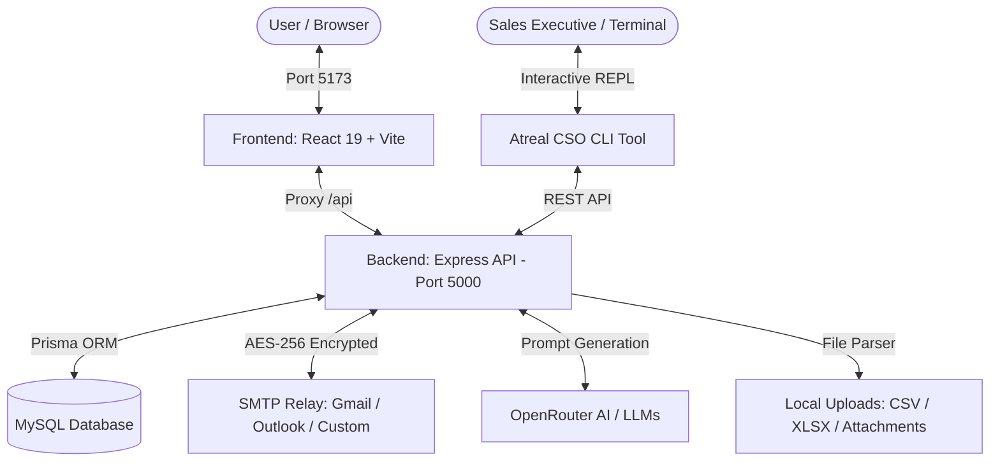

# 🚀 Atreal CSO & Email Campaign Management Platform

<p align="center">
  
  
  
  
  
  
  
  
  
</p>

<p align="center">
  <strong>An enterprise-ready, AI-augmented Email Campaign Management System & Autonomous Multi-Agent Sales Orchestration CLI.</strong>
</p>

---

## 📑 Table of Contents

- [Overview](#-overview)
- [System Architecture](#-system-architecture)
- [Key Features](#-key-features)
- [Tech Stack](#-tech-stack)
- [Project Structure](#-project-structure)
- [Prerequisites](#-prerequisites)
- [Environment Configuration](#-environment-configuration)
- [Installation & Quick Start](#-installation--quick-start)
- [Default Login Credentials](#-default-login-credentials)
- [Atreal CSO Agent CLI](#-atreal-cso-agent-cli)
- [REST API Endpoints](#-rest-api-endpoints)
- [Troubleshooting & FAQs](#-troubleshooting--faqs)
- [License](#-license)

---

## 🌟 Overview

The **Atreal CSO & Email Campaign Platform** is a full-stack solution designed for high-deliverability email marketing, lead tracking, automated outreach, and intelligent campaign orchestration. 

It combines a sleek, modern **React 19 web dashboard** with a robust **Node.js/Express & Prisma REST backend**, plus an interactive **multi-agent terminal CLI** for automated sales intelligence powered by OpenRouter AI.

---

## 🏗️ System Architecture



---

## ⚡ Key Features

### 📧 Email Campaign Management
- **Visual & HTML Template Designer:** Craft rich-text or HTML emails with dynamic personalization tags (`{{name}}`, `{{company}}`).
- **Flexible Campaign Execution:** Launch instant email blasts, schedule timed campaigns, pause, or resume anytime.
- **Batching & Rate Control:** Built-in safeguards with configurable batch sizes, inter-email delay limits, and retry handling to protect domain reputation.
- **Delivery & Bounce Tracking:** Monitor recipient statuses: `SENT`, `FAILED`, `BOUNCED`, and `UNSUBSCRIBED`.

### 👥 Audience & Contact Segmentation
- **Excel/CSV Bulk Importer:** Parse and ingest contact lists with field mapping in seconds.
- **Tags & Contact Groups:** Segment audiences based on custom tags, business verticals, or campaign engagement.
- **Contact Hygiene:** Instant filtering of active, inactive, and bounced contacts.

### 🔐 Secure Multi-Provider SMTP Manager
- **Multi-Tenant Credentials:** Connect multiple accounts across Gmail, Outlook, Zoho, Office 365, or custom SMTP servers.
- **AES-256 Encryption:** All SMTP account passwords and sensitive credentials are encrypted before hitting the database.
- **Live Connection Tester:** Instant zero-latency verification of SMTP credentials directly from the UI.

### 📊 Real-Time Analytics & Dashboard
- Visual KPIs: Total emails sent, delivery success rate, open & click estimates.
- Interactive time-series charts powered by **Recharts**.
- Full audit logs and downloadable reports.

### 🤖 Atreal Multi-Agent CSO System & CLI
- **Terminal REPL (`npm run cli`):** Command-line sales environment with 7+ dedicated AI agents:
  - 📩 `/email` — Email Agent (Outreach strategy & copy generation)
  - 🎯 `/lead` — Lead Agent (Prospect discovery & qualification)
  - 📇 `/crm` — CRM Agent (Pipeline management & contact hygiene)
  - 📝 `/proposal` — Proposal Agent (Sales quote & contract drafting)
  - 🔍 `/research` — Research Agent (Market & company background intelligence)
  - 📅 `/meeting` — Meeting Agent (Scheduling & briefing prep)
  - 📈 `/analytics` — Analytics Agent (Performance summaries & KPIs)

---

## 🛠️ Tech Stack

| Domain | Technologies & Libraries |
| :--- | :--- |
| **Frontend** | React 19, TypeScript, Vite 6, Tailwind CSS v4, Radix UI, Lucide Icons, Framer Motion, TanStack Query, Zustand, Axios, Recharts |
| **Backend** | Node.js, Express.js, TypeScript, Prisma ORM, Zod, Nodemailer, Multer, XLSX, Helmet, Morgan, Cookie-Parser |
| **Database** | MySQL (8.0+) via Prisma Client |
| **Security** | JWT (Access + HTTP-only Refresh), bcryptjs, AES-256 symmetric credential encryption, Express Rate Limiter |
| **AI Integration** | OpenRouter API (`openrouter/auto`) for automated content and multi-agent coordination |
| **CLI Tool** | Inquirer, Chalk, Ora, Figlet, Boxen, Conf, CLI-Table3 |

---

## 📁 Project Structure

```plaintext
Atreal-cso-cli/
├── .env.example              # Master environment configuration template
├── package.json              # Monorepo scripts (concurrent dev, cli runner)
├── start.bat                 # One-click dual-server Windows launcher
├── backend/                  # Node.js + Express + Prisma API
│   ├── .env.example          # Backend environment example
│   ├── prisma/
│   │   ├── schema.prisma     # Complete relational database models
│   │   └── seed.ts           # Admin user & system default settings seed
│   ├── src/
│   │   ├── agents/           # Multi-agent AI engine (Lead, CRM, Email, etc.)
│   │   ├── config/           # Database, CORS, and Zod environment schemas
│   │   ├── controllers/      # Route controllers (Auth, Campaign, SMTP, etc.)
│   │   ├── middleware/       # Auth guards, Rate limiters, Error handlers
│   │   ├── routes/           # REST endpoint definitions
│   │   ├── services/         # Mailer, Encryption, and Token services
│   │   └── server.ts         # Server entry point with graceful shutdown
│   └── uploads/              # Local storage for CSV imports and templates
├── frontend/                 # React 19 + Vite Web Application
│   ├── src/
│   │   ├── components/       # Reusable UI elements (Buttons, Modals, Forms)
│   │   ├── pages/            # Dashboard, Campaigns, Contacts, SMTP, AI, Reports
│   │   ├── services/         # Axios API clients & interceptors
│   │   ├── store/            # Zustand global state (Auth, Theme)
│   │   └── App.tsx           # Route definitions & protected layouts
│   └── vite.config.ts        # Vite configuration with /api reverse proxy
├── cli/                      # Universal Agent CLI
│   └── src/
│       ├── bin/agent.ts      # Interactive terminal REPL entry point
│       └── core/             # CLI commands, state manager, and renderers
└── docs/                     # Architectural, API & Deployment guides
```

---

## 📋 Prerequisites

Before getting started, make sure you have the following installed:

1. **Node.js**: v18.0.0 or higher ([Download Node.js](https://nodejs.org/))
2. **npm** (comes with Node) or **yarn**
3. **MySQL Server**: v8.0+ running locally (e.g. through [XAMPP](https://www.apachefriends.org/), Docker, or native MySQL Service)
4. *(Optional)* **OpenRouter API Key** for AI copywriting & agent queries ([Get OpenRouter Key](https://openrouter.ai/))

---

## ⚙️ Environment Configuration

The application uses environment variables for database connections, JWT secrets, encryption keys, and AI features.

### 1. Create `.env` Files

Copy `.env.example` in both the project root and `backend/`:

```bash
# In the root directory:
cp .env.example .env

# In the backend directory:
cp .env.example backend/.env
```

### 2. Environment Variables Reference

| Variable | Required | Default / Example | Purpose |
| :--- | :---: | :--- | :--- |
| `NODE_ENV` | Yes | `development` | Runtime environment (`development`, `production`) |
| `PORT` | Yes | `5000` | Port for Express backend server |
| `APP_URL` | Yes | `http://localhost:5173` | Frontend origin URL |
| `API_URL` | Yes | `http://localhost:5000` | Backend API base URL |
| `DATABASE_URL` | **Yes** | `mysql://root:@localhost:3306/emailcampaign_db` | MySQL connection string for Prisma |
| `JWT_ACCESS_SECRET` | **Yes** | `32+ characters secret` | Secret key for signing access tokens |
| `JWT_REFRESH_SECRET`| **Yes** | `32+ characters secret` | Secret key for refresh tokens |
| `ENCRYPTION_KEY` | **Yes** | `32 characters exact` | AES-256 key for encrypting SMTP passwords |
| `ENCRYPTION_IV` | **Yes** | `16 characters exact` | Initialization Vector for AES encryption |
| `CORS_ORIGIN` | Yes | `http://localhost:5173` | Allowed frontend origin for CORS |
| `UPLOAD_DIR` | Yes | `./uploads` | Directory for uploaded attachments & spreadsheets |
| `OPENROUTER_API_KEY`| No | `sk-or-v1-...` | API Key for OpenRouter AI integration |
| `OPENROUTER_MODEL` | No | `openrouter/auto` | LLM model selector |

> [!IMPORTANT]
> - `ENCRYPTION_KEY` **must be exactly 32 characters** (e.g., `12345678901234567890123456789012`).
> - `ENCRYPTION_IV` **must be exactly 16 characters** (e.g., `1234567890123456`).
> - `JWT_ACCESS_SECRET` and `JWT_REFRESH_SECRET` must be at least 32 characters long.

---

## 🚀 Installation & Quick Start

### Step 1: Clone the Repository

```bash
git clone https://github.com/your-username/Atreal-cso-cli.git
cd Atreal-cso-cli
```

### Step 2: Install All Dependencies

Install dependencies across the root, backend, frontend, and CLI in one command:

```bash
npm run install:all
```

*(Or manually `npm install` inside the root, `backend`, `frontend`, and `cli` directories).*

### Step 3: Setup MySQL Database

1. Start your local **MySQL server** (e.g., start MySQL in XAMPP control panel or `mysql -u root`).
2. Create the target database (if not automatically created):
   ```sql
   CREATE DATABASE IF NOT EXISTS emailcampaign_db;
   ```
3. Push schema and seed the database:
   ```bash
   cd backend
   npx prisma db push
   npm run prisma:seed
   cd ..
   ```

> [!TIP]
> If your MySQL reports `Table doesn't exist in engine` due to prior corrupt local tables, run:
> ```bash
> npx prisma db push --force-reset
> npm run prisma:seed
> ```

### Step 4: Run the Application

You have two convenient options to start both the Frontend and Backend:

#### Option A: Single Command (Cross-Platform)
```bash
npm run dev
```
*This uses `concurrently` to start the backend on port `5000` and the frontend on port `5173` simultaneously.*

#### Option B: Windows Launcher
Double-click `start.bat` or run:
```cmd
start.bat
```

### Step 5: Access the Platform

- 🌐 **Web Application Dashboard:** [http://localhost:5173](http://localhost:5173)
- 🔌 **Backend API Health Check:** [http://localhost:5000/api/health](http://localhost:5000/api/health)

---

## 👤 Default Login Credentials

After running `npm run prisma:seed`, the system is pre-loaded with an initial Admin account:

| Field | Seeded Value |
| :--- | :--- |
| **Email** | `admin@emailcampaign.com` |
| **Password** | `Admin@123` |
| **Role** | `ADMIN` |

---

## 🤖 Atreal CSO Agent CLI

Experience the conversational sales intelligence CLI directly from your terminal:

```bash
npm run cli
```

### CLI Slash Commands

Once inside the interactive prompt, switch between specialist agents or manage tasks:

| Command | Description |
| :--- | :--- |
| `/help` | Display the list of all available agent commands |
| `/email` | Switch to the **Email Agent** (Email campaign planning & copy) |
| `/lead` | Switch to the **Lead Agent** (Prospect discovery & lead enrichment) |
| `/crm` | Switch to the **CRM Agent** (Contact records & pipeline status) |
| `/proposal` | Switch to the **Proposal Agent** (Sales proposals & quotations) |
| `/research`| Switch to the **Research Agent** (Company & market intelligence) |
| `/meeting` | Switch to the **Meeting Agent** (Meeting schedules & briefs) |
| `/analytics`| Switch to the **Analytics Agent** (Outreach statistics & metrics) |
| `/settings` | View and edit CLI configuration & API connections |
| `/logout` | Log out from the current CLI session |
| `/exit` | Exit the CLI tool |

---

## 📡 REST API Endpoints

All backend endpoints are prefixed with `/api`.

### 🛡️ Authentication (`/api/auth`)
- `POST /api/auth/register` — Create a new user account
- `POST /api/auth/login` — Sign in and receive access token + refresh cookie
- `POST /api/auth/refresh-token` — Rotate and obtain a new access token
- `POST /api/auth/logout` — Invalidate session and clear auth cookies
- `GET  /api/auth/me` — Retrieve authenticated user profile

### 📬 SMTP Accounts (`/api/smtp`)
- `GET  /api/smtp` — List all configured SMTP connections
- `POST /api/smtp` — Register new SMTP account (Credentials encrypted with AES-256)
- `POST /api/smtp/:id/test` — Live test connection to SMTP server
- `PUT  /api/smtp/:id` — Update credentials/settings
- `DELETE /api/smtp/:id` — Remove an SMTP account

### 👥 Contacts (`/api/contacts`)
- `GET  /api/contacts` — Fetch contacts with search, pagination, and group filters
- `POST /api/contacts` — Create individual contact
- `POST /api/contacts/import` — Upload and parse CSV or XLSX contact list
- `PUT  /api/contacts/:id` — Update contact information
- `DELETE /api/contacts/:id` — Delete a contact

### 📝 Email Templates (`/api/templates`)
- `GET  /api/templates` — List all saved templates
- `POST /api/templates` — Save a new template
- `GET  /api/templates/:id` — Retrieve template HTML and metadata
- `PUT  /api/templates/:id` — Update existing template
- `DELETE /api/templates/:id` — Delete template

### 🚀 Campaigns (`/api/campaigns`)
- `GET  /api/campaigns` — Fetch list of campaigns with status & progress
- `POST /api/campaigns` — Create a new campaign (draft or scheduled)
- `GET  /api/campaigns/:id` — Get campaign details and recipient logs
- `POST /api/campaigns/:id/start` — Launch/Resume a campaign
- `POST /api/campaigns/:id/pause` — Temporarily halt campaign dispatch
- `DELETE /api/campaigns/:id` — Delete campaign

### 📊 Reports & AI (`/api/reports` & `/api/ai-command`)
- `GET  /api/reports/overview` — Aggregated metrics (Sent, Failed, Success Rate)
- `POST /api/ai-command/generate` — Generate email subject lines & body copy with AI

---

## 🛠️ Troubleshooting & FAQs

### Q: Why do I see `{"success":false,"message":"Endpoint not found"}` when visiting `http://localhost:5000/`?
> **A:** The backend is a dedicated REST API service. There is no web page mounted at the root `/`. 
> - To check that the backend is alive, navigate to **`http://localhost:5000/api/health`**.
> - To open the web application, visit **`http://localhost:5173`**. The Vite server automatically proxies all `/api` requests to the backend.

---

### Q: MySQL error: `Error 1932: Table 'emailcampaign_db.users' doesn't exist in engine`
> **A:** This occurs when MySQL/XAMPP retains metadata for tables whose physical `.ibd` files were moved or corrupted.
> Fix it by resetting and seeding fresh tables:
> ```bash
> cd backend
> npx prisma db push --force-reset
> npm run prisma:seed
> ```

---

### Q: How do I change the default admin password?
> **A:** Log into the dashboard, navigate to **Settings -> Profile**, and update your password, or change the hash in `backend/prisma/seed.ts` and re-seed.

---

### Q: How do I configure my own SMTP server (e.g., Gmail)?
> **A:** 
> 1. In Gmail, enable 2-Factor Authentication and create an **App Password** (not your regular account password).
> 2. Open the Web Dashboard at `http://localhost:5173`.
> 3. Go to **SMTP Settings** -> **Add New Account**.
> 4. Select **Gmail**, enter your email, paste the App Password, and click **Test Connection**.

---

## 📜 Available Scripts

| Location | Command | Action |
| :--- | :--- | :--- |
| **Root** | `npm run dev` | Runs both backend and frontend concurrently |
| **Root** | `npm run cli` | Launches the interactive multi-agent terminal CLI |
| **Root** | `npm run install:all` | Installs dependencies across all sub-projects |
| **Backend** | `npm run dev` | Runs Express server with nodemon & TypeScript watcher |
| **Backend** | `npm run prisma:generate` | Re-generates Prisma client bindings |
| **Backend** | `npm run prisma:seed` | Seeds the database with default admin & settings |
| **Backend** | `npm run prisma:studio` | Opens Prisma visual database GUI on port 5555 |
| **Frontend** | `npm run dev` | Starts Vite development server on port 5173 |
| **Frontend** | `npm run build` | Builds optimized production bundle |

---

## 📄 License

<<<<<<< HEAD
This project is licensed under the [MIT License](LICENSE).
=======
This project is licensed under the [MIT License](LICENSE).
>>>>>>> 5571c8a38ebf7eb92380a201f7fe3b9639961108
